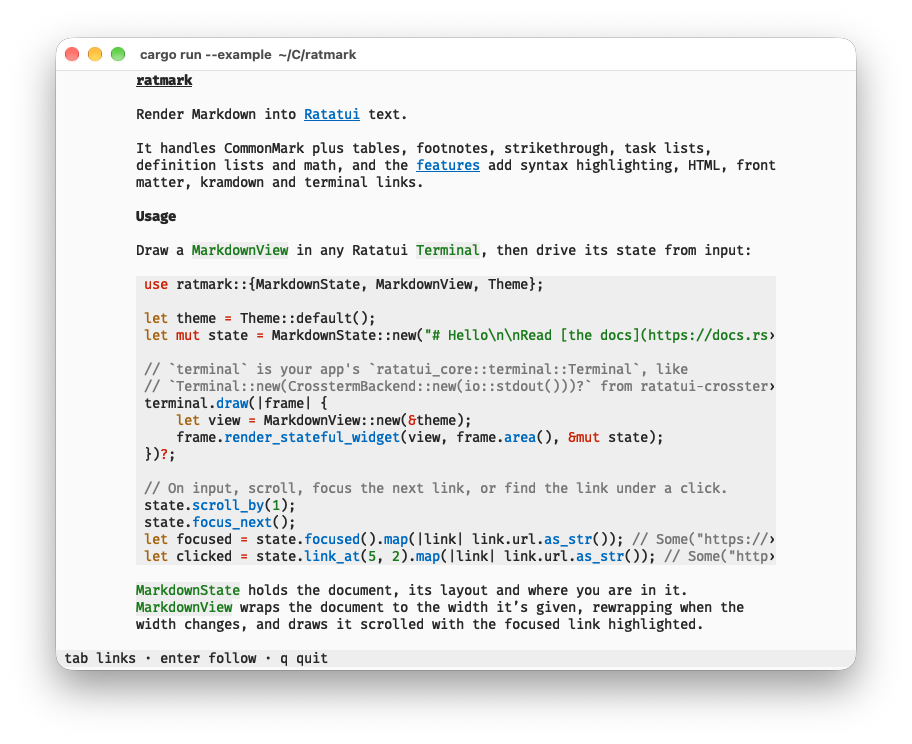
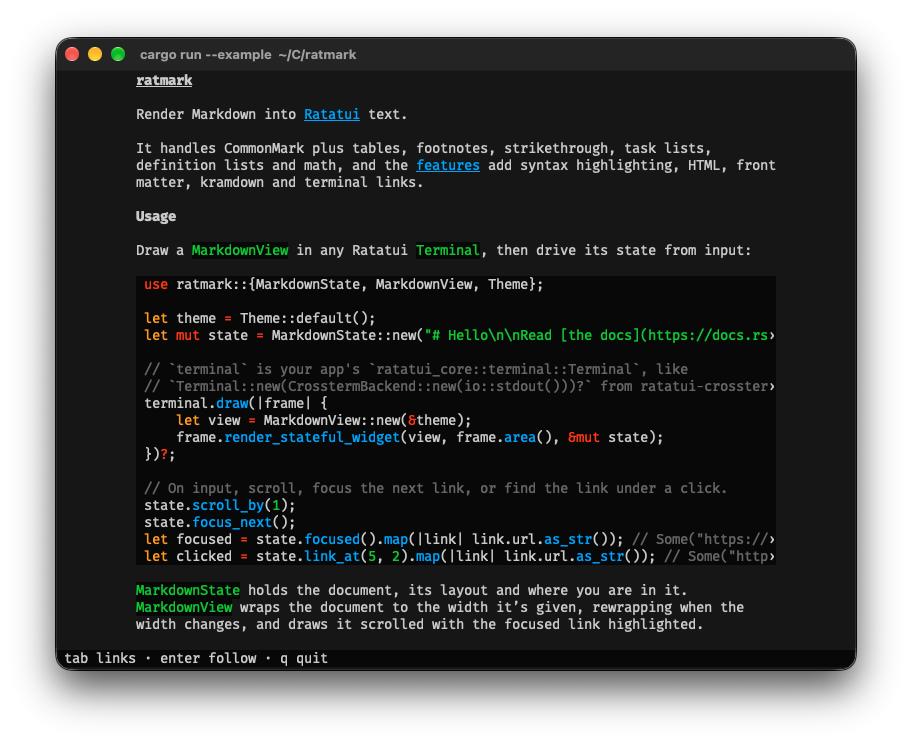

# ratmark

[](https://github.com/nixpulvis/ratmark/actions/workflows/ci.yml)
[](https://nixpulvis.com/ratmark/)

Render Markdown into [Ratatui] text.

It handles CommonMark plus tables, footnotes, strikethrough, task lists,
definition lists and math, and the [features](#features) add syntax
highlighting, HTML, front matter, kramdown and terminal links.



## Usage

Draw a `MarkdownView` in any Ratatui `Terminal`, then drive its state from
input:

```rust
use ratmark::{MarkdownState, MarkdownView, Theme};

let theme = Theme::default();
let mut state = MarkdownState::new("# Hello\n\nRead [the docs](https://docs.rs/ratmark).");

// `terminal` is your app's `ratatui_core::terminal::Terminal`, like
// `Terminal::new(CrosstermBackend::new(io::stdout()))?` from ratatui-crossterm.
terminal.draw(|frame| {
    let view = MarkdownView::new(&theme);
    frame.render_stateful_widget(view, frame.area(), &mut state);
})?;

// On input, scroll, focus the next link, or find the link under a click.
state.scroll_by(1);
state.focus_next();
let focused = state.focused().map(|link| link.url.as_str()); // Some("https://docs.rs/ratmark")
let clicked = state.link_at(5, 2).map(|link| link.url.as_str()); // Some("https://docs.rs/ratmark")
```

`MarkdownState` holds the document, its layout and where you are in it.
`MarkdownView` wraps the document to the width it's given, rewrapping when the
width changes, and draws it scrolled with the focused link highlighted.

## Input

Keys and clicks map onto `MarkdownState` methods like `scroll_by`, `shift_at`,
`focus_next` and `link_at`. See its [docs][MarkdownState] for the rest.

Mouse wheels, trackpads and touch go through [`gesture`][gesture], which locks
each gesture to one axis. Use [`terminal::Wheel`][Wheel] in a terminal, or
[`web::listen`][listen] in the browser with the [`web`](#web) feature.

## Examples

`tui` is a full-screen reader, `MarkdownState` driving a small app that scrolls,
follows links and shifts wide code sideways, with the keyboard and mouse.
Without a file it shows a guide to its keys. Turn on the features a file needs,
like `syntax` to highlight the code in this one:

```sh
cargo run --example tui --features syntax -- README.md
```

## Features

All features are off by default. Each, but `web`, has an example that prints a
short document, drawn by `MarkdownView` with Ratatui's crossterm backend, to the
terminal in color. They need an interactive terminal, not a pipe.

### `syntax`

Code blocks are syntax highlighted with [syntect]. It uses syntect's pure Rust
regex engine, so ratmark also builds for `wasm32-unknown-unknown` and works in
the browser with something like [Ratzilla].

```sh
cargo run --example syntax --features syntax
```

### `front-matter-yaml` and `front-matter-toml`

These help with Markdown from static sites. They split YAML front matter,
between `---` lines, or TOML front matter, between `+++` lines, off the top of a
document, and deserialize it into your own serde types with [serde-saphyr] or
[toml].

```sh
cargo run --example front_matter --features front-matter-yaml
```

### `kramdown`

Reads Markdown written for kramdown, since that's what Jekyll uses, with
[pulldown-kram]. Attribute lists like `{: #intro .note lang="en"}` are read off
blocks and spans, `{:toc}` lists become tables of contents, and Markdown inside
`markdown="1"` elements is rendered as Markdown.

Turn on `html` with it. kramdown reads the text inside elements like `<kbd>` as
HTML, so without `html` that text is left out too.

```sh
cargo run --example kramdown --features kramdown
```

### `html`

Markdown written for real sites tends to have HTML mixed in. ratmark reads the
text, links and simple formatting out of it with [html5gum]'s tokenizer instead
of printing tags. Without this feature, HTML is left out.

```sh
cargo run --example html --features html
```

### `links`

The view also writes each link's URL into its cells, so backends that support it
draw links the terminal or browser knows about, like OSC 8. It needs Ratatui's
cell extensions, which aren't released yet ([ratatui#2854]), and
`MarkdownState::with_link_base` makes the links absolute.

```sh
cargo run --example links --features links
```

### `web`

Follows a browser's wheel and touch events over the element a view is drawn in,
like [Ratzilla]'s, with `gesture::web::listen`. It needs
`wasm32-unknown-unknown`, and a browser to try it in.

## Testing

`cargo test` runs the unit tests. To check a pile of real documents, pass the
`corpus` test a directory of Markdown files, searched recursively. Every file
is rendered at several widths, checking that nothing panics and no line is too
wide.

```sh
cargo test --features kramdown --test corpus -- path/to/markdown
```

`cargo run --example dump -- FILE WIDTH` prints a file as rendered, without
colors, which is handy for eyeballing layout.

## Credit

The idea and the look come from Tyler Bloom's blog, [The Avid
Rustacean][avid-rustacean], which renders its posts with Ratatui in the browser.
`ratmark` is a fresh implementation, not a copy of that code.

## License

Licensed under either of [Apache License, Version 2.0](LICENSE-APACHE) or
[MIT license](LICENSE-MIT) at your option.

[Ratatui]: https://ratatui.rs
[syntect]: https://github.com/trishume/syntect
[html5gum]: https://github.com/untitaker/html5gum
[serde-saphyr]: https://github.com/bourumir-wyngs/serde-saphyr
[toml]: https://github.com/toml-rs/toml
[pulldown-kram]: https://github.com/nixpulvis/pulldown-kram
[Ratzilla]: https://github.com/orhun/ratzilla
[avid-rustacean]: https://github.com/TylerBloom/avid-rustacean
[ratatui#2854]: https://github.com/ratatui/ratatui/issues/2854
[MarkdownState]: https://nixpulvis.com/ratmark/ratmark/struct.MarkdownState.html
[gesture]: https://nixpulvis.com/ratmark/ratmark/gesture/index.html
[Wheel]: https://nixpulvis.com/ratmark/ratmark/gesture/terminal/struct.Wheel.html
[listen]: https://nixpulvis.com/ratmark/ratmark/gesture/web/fn.listen.html
